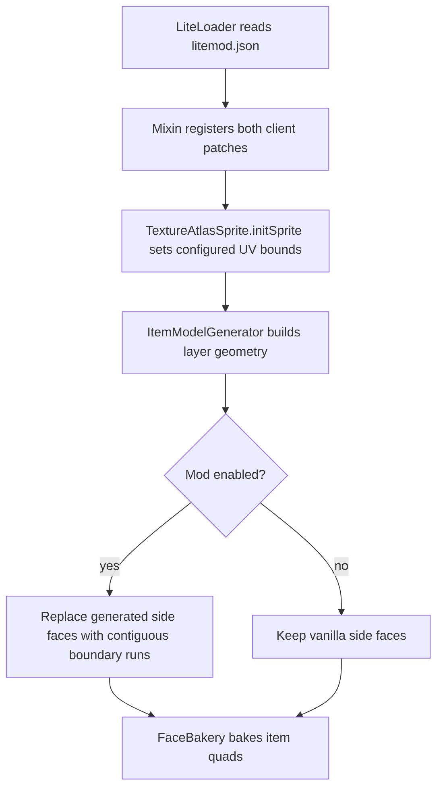

# Architecture and rendering

## Source layout

```text
build.gradle                     ForgeGradle, LiteLoader packaging and Mixin processing
settings.gradle                  Gradle project name
gradle.properties                Mod versions, mappings, artifact name and JVM options
gradle/wrapper/                   Gradle 4.10.3 wrapper
src/main/java/dev/froyln/modelgapfix/
  Config.java                    Read-only configuration and enabled/disabled values
  ModelFix.java                  Generated side faces, UV sampling and geometry adjustment
  mixin/
    TextureAtlasSpriteMixin.java  Sprite UV bounds override
    ItemModelGeneratorMixin.java Generated side-face return injection
src/main/resources/
  mixins.modelgapfix.json         Client-only mixin list and generated refmap reference
src/test/java/
  dev/froyln/modelgapfix/GeneratedItemEdgesTest.java
  net/minecraft/client/renderer/block/model/ModelFixEnlargeFacesTest.java
```

## Loading and resource baking

The Gradle LiteLoader plugin generates `litemod.json` inside the artifact. LiteLoader reads
its `mixinConfigs` entry and registers `mixins.modelgapfix.json`. Both patches belong to
that config's `client` list. The refmap generated during compilation maps readable MCP method
and field names to production names. The artifact is a ZIP/JAR with a `.litemod` extension.

The mixin package is `dev.froyln.modelgapfix.mixin`. Mixin reserves that entire package
prefix, so directly called helpers live in its parent package. Using a Minecraft package
as the mixin prefix can prevent ordinary target/helper classes from loading. The current
implementation avoids Minecraft's package-private `ItemModelGenerator.Span` types.



These operations happen during resource/model construction, rather than every render frame.
The mod has no network calls, gameplay changes, server component or file writes.

## Sprite UV bounds

Minecraft 1.12.2 applies a `0.01f` texel inset to each side of a sprite's atlas UV rectangle.
`TextureAtlasSpriteMixin` overwrites `initSprite(int, int, int, int, boolean)`, preserving
origin and rotation bookkeeping while taking the inset from `Config.uvInset()`.

For example, `minU = x / atlasWidth + inset / atlasWidth`, with float arithmetic. The default
inset is zero. An inset of `0.01` restores vanilla sprite bounds, while `enabled=false` also
disables the independent item correction. Reducing the inset trades protection from adjacent
atlas textures for fewer seams.

## Generated item side faces

The item hook targets exactly this overload:

```text
getBlockParts(TextureAtlasSprite, String, int) -> List<BlockPart>
```

The full descriptor distinguishes it from the other overload with the same MCP name. A
cancellable injection at `RETURN` replaces only the side-face list when enabled. Vanilla
still constructs the front/back element and combines it with those sides. Each layer keeps
its texture name, tint index and vanilla shading flag.

`ModelFix.generateSideParts` performs these steps:

1. Read each sprite frame's level-zero pixels. A pixel is opaque for boundary detection when
   its alpha is nonzero; out-of-bounds positions count as transparent.
2. Find opaque-to-transparent transitions for top, bottom, left and right edges. Union each
   boundary position across frames before constructing runs. This retains edges needed by
   any frame without emitting overlapping faces for changing run lengths.
3. Merge adjacent boundary positions on the same row or column. A transparent break creates
   a separate run, unlike vanilla's span merging across distant pixels.
4. Build public `BlockPart`, `BlockPartFace` and `BlockFaceUV` objects. Coordinates scale into
   the 0–16 model space, invert image Y, and initially use Z planes at 7.5 and 8.5.
5. Sample the center of the opaque row/column across the item's thickness. Along a run, UV
   endpoints sit `0.0001` texels inside the endpoints. This replaces 1.12.2's perpendicular
   `anchor/(dimension-1)` sampling and avoids a zero denominator for one-pixel dimensions.
6. Expand and recess the single-face geometry to close small geometry seams.

Image-left edges have an EAST face at their left X boundary; image-right edges have a WEST
face at their right boundary. This follows vanilla 1.12.2's model convention. Vertical
parts keep vanilla's reversed Y endpoints and matching reversed V coordinates.

## Geometry adjustment and scope

`EXPANSION = 0.02` and `INDENT = 0.0001` are model-unit constants, not configuration keys.
UP/DOWN faces grow in X/Z and move inward in Y; EAST/WEST faces grow in Y/Z and move inward
in X. Parts with multiple faces, and NORTH/SOUTH faces, remain unchanged by this helper.
The expansion was increased from an earlier port value; it is not an upstream default claim.

The global sprite patch also affects sprites used by custom models. Custom multi-face
geometry is not rebuilt by the generated-item hook. Resource packs, transparency, mipmaps,
other renderer mods and GPU behavior can influence the final appearance. See the manual
checks in [development.md](development.md) before claiming a particular combination works.
